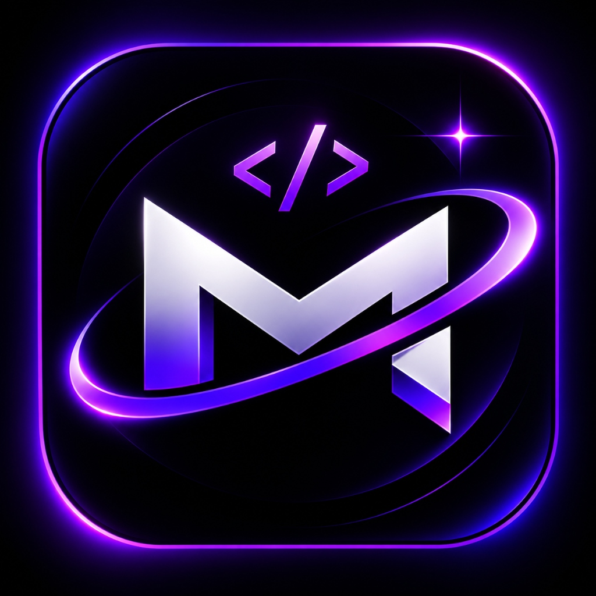

# Mukteswar Gochhayat — 3D Developer Portfolio

<div align="center">
  
  
  <h3>Interactive 3D Developer Portfolio built with React 18, Three.js, and TypeScript</h3>

  <p align="center">
    <a href="https://react.dev/"></a>
    <a href="https://threejs.org/"></a>
    <a href="https://www.typescriptlang.org/"></a>
    <a href="https://vite.dev/"></a>
    <a href="https://tailwindcss.com/"></a>
  </p>
</div>

---

## 🌟 Overview

Welcome to the personal 3D Developer Portfolio of **Mukteswar Gochhayat**. This project showcases modern web development capabilities by blending interactive 3D graphics, smooth physics-driven motion animations, and a clean, responsive user interface.

### ✨ Key Features

- **Interactive 3D Computer Model:** Real-time 3D desktop workstation rendered using React Three Fiber and Three.js with full dynamic lighting, shadows, and responsive scaling.
- **3D Floating Tech Spheres:** Interactive Decal-mapped icosahedron spheres representing core tech stack competencies with floating physics animations.
- **3D Rotating Earth:** Realistic celestial planet model rendered inside an interactive orbit container.
- **Animated Cosmic Stars Background:** Dynamic mathematical point-cloud particle starfield with continuous subtle rotation.
- **Modern UI / UX:** Built with Tailwind CSS, custom gradients, glassmorphism cards, and Framer Motion spring transitions.
- **Interactive Experience Timeline:** Step-by-step career and project milestones visualized with vertical timeline elements.
- **Responsive Navigation:** Smooth section scrolling with automatic scroll-position highlighting and mobile navigation drawer.
- **Direct Contact Form:** Integrated EmailJS support for instant messaging without requiring a dedicated backend server.

---

## 🛠️ Tech Stack

- **Core Framework:** React 18 (TypeScript)
- **Bundler & Tooling:** Vite, ESLint, Prettier, PostCSS
- **3D Graphics:** Three.js, `@react-three/fiber`, `@react-three/drei`, `maath`
- **Animations:** Framer Motion, Tilt (`react-parallax-tilt`)
- **Styling:** Tailwind CSS
- **Timeline:** React Vertical Timeline Component
- **Email Service:** EmailJS Browser SDK

---

## 📁 Project Structure

```text
reactjs18-3d-portfolio/
├── public/                 # Static assets and 3D GLTF/GLB models
│   ├── desktop_pc/         # 3D Desktop computer model & textures
│   ├── planet/             # 3D Earth planet model & textures
│   └── logo.png            # Personal branding logo
├── src/
│   ├── assets/             # Icons, badges, project images, and branding
│   ├── components/
│   │   ├── atoms/          # Atomic UI elements (Header, etc.)
│   │   ├── canvas/         # 3D Canvas scenes (Computers, Ball, Earth, Stars)
│   │   ├── layout/         # Layout components (Navbar, Loader)
│   │   └── sections/       # Page sections (Hero, About, Experience, Tech, Works, Feedbacks, Contact)
│   ├── constants/          # Application configuration, navigation, and portfolio data
│   │   ├── config.ts       # Personal info, headers, and form configurations
│   │   ├── index.ts        # Services, tech stack, experiences, and projects data
│   │   └── styles.ts       # Shared Tailwind style constants
│   ├── hoc/                # Higher-Order Components (SectionWrapper)
│   ├── types/              # TypeScript type declarations
│   ├── utils/              # Animation helpers and motion variants
│   ├── App.tsx             # Root application component
│   ├── globals.css         # Global styles and custom keyframes
│   └── main.tsx            # Application entry point
├── package.json            # Dependencies and npm scripts
├── tailwind.config.cjs     # Tailwind CSS configuration
├── tsconfig.json           # TypeScript configuration
└── vite.config.js          # Vite bundler configuration
```

---

## 🚀 Getting Started

### Prerequisites

- [Node.js](https://nodejs.org/) (version 18+ or later recommended)
- [npm](https://www.npmjs.com/) or [yarn](https://yarnpkg.com/)

### Installation

1. Clone or open the repository:
   ```bash
   cd reactjs18-3d-portfolio
   ```

2. Install dependencies:
   ```bash
   npm install
   ```

3. Configure Environment Variables (Optional for Contact Form):
   Create a `.env` file in the root folder with your EmailJS credentials:
   ```env
   VITE_EMAILJS_SERVICE_ID=your_service_id
   VITE_EMAILJS_TEMPLATE_ID=your_template_id
   VITE_EMAILJS_ACCESS_TOKEN=your_public_key
   ```

4. Start the development server:
   ```bash
   npm run dev
   ```

5. Open your browser and navigate to `http://localhost:5173` (or the port shown in your terminal).

---

## 📦 Scripts

- `npm run dev` — Starts the local Vite development server with Hot Module Replacement (HMR).
- `npm run build` — Type-checks and bundles the application for production into `dist/`.
- `npm run preview` — Previews the production build locally.
- `npm run lint` — Runs ESLint checks across the TypeScript codebase.
- `npm run ts:check` — Validates TypeScript types without emitting files.

---

## 👤 Author

**Mukteswar Gochhayat**
- Role: Full Stack & 3D Web Developer
- GitHub: [github.com/mukteshwar845](https://github.com/mukteshwar845)
- LinkedIn: [Mukteswar Gochhayat](https://www.linkedin.com/in/mukteswar-gochhayat-119a80368)
- Contact: Reach out directly via the Portfolio Contact Form or LinkedIn

---

## 📄 License

This project is open-source and available under the [MIT License](LICENSE).

